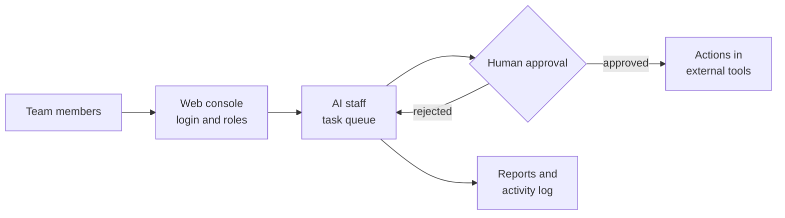

# AI Agent Case Studies

Selected client work by **Chong Jia You** ([Comanta Solutions](https://comanta.com.my/)).

These are overviews only. The systems were built for paying clients, so source code, client names, business data and implementation details are not published. I am happy to walk through the design in an interview.

---

## Case 1: "AI staff" operations console for an e-commerce business

**Status:** delivered to the client, under active development

### The problem

A small online retail team was running its daily operations by hand across several unconnected tools: marketplace back offices, a messaging app, bank statements and spreadsheets. Routine work took most of the day, and mistakes were only found afterwards.

### What I built

A private, multi-user web console where each routine job is handled by an "AI staff member". Staff assign work, the agent prepares it, and a person approves anything that matters before it is carried out.

### Capability areas

| Area | What it covers |
| --- | --- |
| Access and accounts | Sign-in, roles and permissions, limited guest accounts |
| Task dispatch | Assigning work to AI staff, scheduling, handover between shifts |
| Human approval | Every sensitive action waits for a person to approve it |
| Customer messages | Reading incoming orders and enquiries from a messaging channel and preparing replies |
| Orders and shipping | Turning messages into orders, address handling, shipment preparation |
| Finance | Matching bank statement lines against orders, profit reporting |
| Stock | Restock calculation and purchase suggestions |
| Web automation | Operating third-party web tools that have no API, with a person able to take over |
| Oversight | Activity log, diagnostics, backups |

### How it is engineered

- **Human in the loop by design.** The agent proposes and a person disposes. Nothing that spends money or reaches a customer goes out unapproved.
- **Checks that do not rely on the model.** Model output is validated by ordinary code before it is used.
- **Tested.** More than 1,400 automated tests cover the business logic.
- **Runs on the client's own premises.** Deployed on their hardware, reachable by the team only.
- **Bilingual interface** for a mixed-language team.

### My role

Sole developer: requirements with the client, system design, implementation, testing, deployment, user guide and ongoing support.

### What I can discuss

Architecture and trade-offs, how approvals and safety checks are designed, how browser automation is kept reliable, testing approach, and lessons from running an agent system with real users.

---

## Contact

- Website: [comanta.com.my](https://comanta.com.my/)
- LinkedIn: [jia-you-chong](https://www.linkedin.com/in/jia-you-chong-860701356)
- GitHub: [@programmermars](https://github.com/programmermars)
